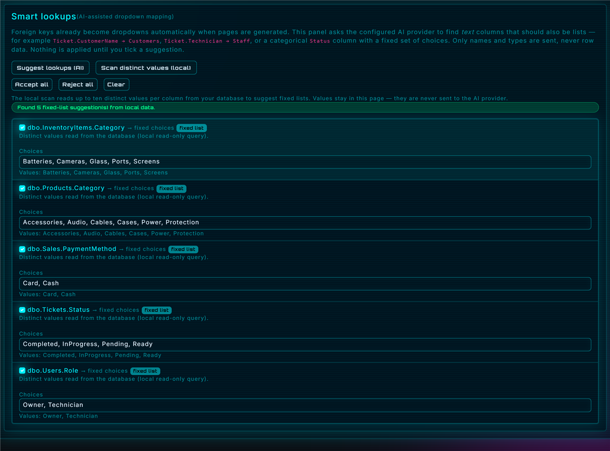
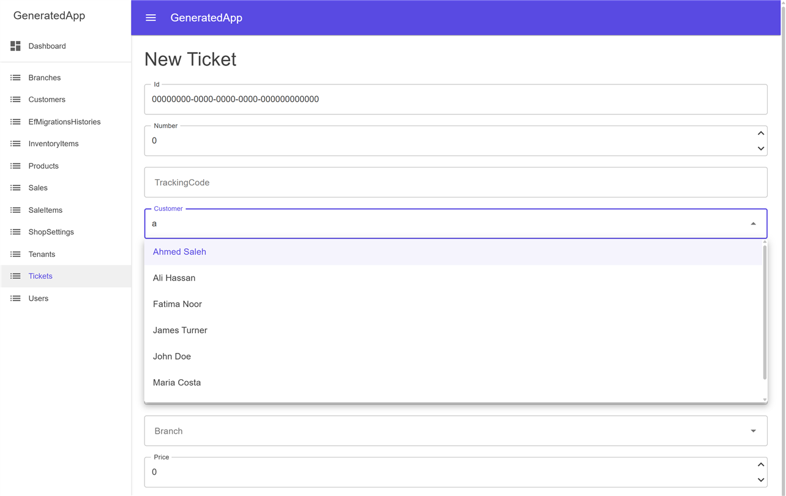

# SQLAZOR

A Blazor Server workbench that reverse-engineers SQL Server into a runnable
Blazor admin — then lets an AI copilot explain, chart, query, and edit what it
generated.

It reads the database through `sys.tables`, `sys.columns`, `sys.foreign_keys`,
and `sys.indexes` — the same catalogs EF's own scaffolder uses — so it picks up
real column types, nullability, identity and computed columns, composite primary
keys, unique indexes, and FK delete behavior. From that schema it can generate:

- **EF Core model** — one **POCO** per table (`Entities/`), one
  **`IEntityTypeConfiguration<T>`** per table using the Fluent API only — no data
  annotations — with real table/column names preserved via `ToTable(...)` /
  `HasColumnName(...)` (`Configurations/`), and a **`DbContext`** wired through
  `ApplyConfigurationsFromAssembly`.
- **CRUD layer** — DTOs plus Dapper-backed services (Mapster mapping,
  `ResponseResult<T>`), with optional Web API controllers and matching HttpClient
  services.
- **Blazor Server pages** — list/create/edit pages in **Plain**, **MudBlazor**, or
  **Tabler** markup, including **lookup-aware forms** with searchable foreign keys
  and fixed-choice columns.
- **Full project scaffold** — `Program.cs`, `.csproj`, admin layout, dashboard,
  charts, and a dashboard stats service.
- **Everything else** — stored-procedure executors, AI naming and XML docs,
  implicit relationship detection, generation profiles, deep compile validation,
  and the AI assistant described below.

## What's new (v1.2)

- **Image-aware chat** — attach PNG, JPEG, or WebP diagrams, schema screenshots, or UI mockups
  (up to 2 MB each) and the assistant answers against them plus the loaded schema. Works with
  Ollama vision models and OpenRouter vision models; attachments travel with the saved
  conversation and are included in exports.
- **OpenRouter provider with curated free models** — a third provider beside Ollama and DeepSeek,
  using the OpenAI-compatible SSE endpoint with a hardcoded list of `:free` ids (vision models
  included). The API key stays in the local settings file, never in chats or exports.
- **Smart lookups** — every foreign key becomes a searchable picker automatically.
  AI can also map text columns, and a local distinct scan proposes fixed choices
  from categorical columns without sending a single value to the model.
- **Lookup-aware generated forms** — `MudAutocomplete` / `MudSelect` in MudBlazor,
  a search box over a bounded `<select>` in Plain and Tabler, and a shared
  `SearchAsync` (TOP 50, escaped `LIKE`, 60-second cache) on every generated
  Dapper, API, and HttpClient service.
- **Planner safeguards** — suggestions that target unselected tables, missing
  columns, or mismatched types are rejected with a visible warning. Display labels
  fall back to `Name`/`FullName`/`Title`, then `FirstName` + `LastName`, then the
  referenced key.
- **Lookup choices in generation profiles** — accepted keys and edited choices are
  saved with the rest of a profile and re-applied later or on another machine.
- **Refreshed landing page** — the home page now has a Smart lookups section with
  three real captures, updated hero/features/workflow copy, and a `#lookups`
  navigation entry (see [Landing page](#landing-page)).

## Running it

```bash
cd DB2Admin.Portal
dotnet run
```

Then open the URL shown in the console. The default profiles are
`http://localhost:5239` (http) and `https://localhost:7288` (https).

Requires the ASP.NET Core SDK (net10.0) and a NuGet feed reachable for
`Microsoft.Data.SqlClient`, `MudBlazor`, `MudBlazor.ThemeManager`, and
`Microsoft.CodeAnalysis.CSharp` (used to syntax-check generated output).

## Using it

1. **Connect** — paste a connection string, e.g.
   `Server=localhost;Database=MyDb;User Id=sa;Password=...;TrustServerCertificate=True;`
   Click **Test Connection**, then **Load Schema**.
2. **Choose tables** — everything is pre-selected except views (views are
   listed if you tick "Include views", but they won't get FK navigation
   properties since views rarely carry real constraints).
3. **Configure lookups (optional)** — open **Smart lookups** and either ask AI for
   suggestions, run the local distinct scan, or both. Tick the suggestions you
   want, edit their choices, then accept or reject in bulk. Foreign keys already
   become pickers without this step. Save a **generation profile** to reuse the
   selections later.
4. **Generate** — set your root namespace and `DbContext` class name, choose the
   page style and optional layers, then click **Generate**.
5. **Review / Download** — click through files in the left-hand list to preview
   them, run the **deep compile check**, or grab everything as a `.zip`. Every run
   is syntax-checked first (see below).

## Generated code validation

Every **Generate** click parses the produced files before they reach you and
shows the result in a card at the top of **Results**:

- `.cs` files are parsed with Roslyn.
- `.razor` files have their `@code` / `@functions` blocks extracted and parsed
  as C#. Razor markup itself is not compiled.
- `.json` (appsettings) is parsed for well-formedness; `.csproj` / `.slnx` /
  other XML is parsed as XML.
- CSS, JS, HTML, and Markdown files are skipped and counted separately.

Errors are listed as `file:line:column` with the Roslyn/JSON/XML message, and
clicking one jumps to that file in the preview pane. This is a syntax pass, not
a compile: types from EF Core, Dapper, and friends aren't resolved here, so a
clean report means "the generator emitted parseable code", not "the generated
project builds".

### Deep compile check

The Results tab also offers a **Deep compile check**, triggered on demand. It
writes the generated solution/project to a temporary folder and runs
`dotnet build` against it, which resolves references to EF Core, Dapper, Mapster,
and MudBlazor. This catches missing usings, wrong types, and broken wiring that a
syntax pass can't see. It is slower, so it runs only when you click **Run deep
check**; the card then reports the error/warning count for the build.

## Tests

```bash
dotnet test
```

`SQLAZOR.Tests/` is fixture-based and needs no SQL Server. It builds an
in-memory schema covering identity/computed columns, composite PKs, two FKs to
one table, a unique index, a view, a PK-less table, and describable /
non-describable procedures, then (currently **211 tests**, all passing):

- snapshot-tests the generated entity/config/`DbContext` output
- snapshot-tests CRUD output for Plain, MudBlazor, and Tabler pages
- snapshot-tests lookup-aware pages — searchable FK pickers, fixed lists, edit-page
  label seeding, and the generated `SearchAsync` service method
- snapshot-tests the single-project and Clean Architecture scaffolds (GUIDs and
  dates are normalized)
- snapshot-tests stored-procedure output
- asserts every generated file set passes the syntax validator
- unit-tests the validator itself (C#, Razor code blocks, JSON, XML)
- unit-tests the lookup planner (FK lookups, label selection, unselected-table and
  type-mismatch warnings, static-list rules), the local sampler (categorical name
  matching, bounded probe SQL, scanned-vs-AI merge precedence), and the AI lookup
  parser (JSON fences, unknown tables/columns, malformed replies)
- unit-tests generation profiles (save/load round-trip including lookup
  suggestions and accepted keys, import validation, filtering and deletion)
- unit-tests the file-edit assistant and the diff/merge pipeline (regeneration
  safety and manifest handling)
- unit-tests the chat content parser, exporter (Markdown/HTML/JSON/zip, file-name
  inference, sanitization) and the on-disk conversation store
- unit-tests the Markdown renderer (tables, alignment, escaping, link schemes),
  the chart parser (chart JSON, query-result charts, caps, bad payloads), and the
  Arabic/RTL detection rules
- unit-tests the Ollama, DeepSeek and OpenRouter adapters (request shape, bearer auth,
  SSE/NDJSON parsing, error events, JSON mode) and the local AI-settings store

Chat-store tests write to a temporary directory and clean up after themselves, so
they never touch your real `%LOCALAPPDATA%\SQLAZOR\chat-sessions` folder.

Snapshots live under `SQLAZOR.Tests/Snapshots/{suite}/`. A mismatch writes a
`.received` file beside the expected one — copy it over once the change is
intended, then re-run.

## Stored procedures

Procedures don't map cleanly onto EF entities, so they get a different treatment
than tables: no `DbContext`, no Fluent config. Instead, for each procedure you
select, SQLAZOR:

1. Reads its parameters from `sys.parameters`.
2. Asks SQL Server to describe its first result set via
   `sys.dm_exec_describe_first_result_set` — this is metadata inference, not
   real execution, so it's safe to run against any procedure without side effects.
3. If the result set **can** be described: generates a `{Name}Result` POCO plus
   a static `{Name}Executor` class with a hand-written `ExecuteAsync(SqlConnection, ...)`
   method — explicit `SqlParameter`s (with correct `SqlDbType`, size, and
   precision/scale), a manual `SqlDataReader` → POCO mapper using
   `GetOrdinal("column")` + typed `GetXxx()` calls with null checks, no reflection.
4. If it **can't** be described (dynamic SQL, temp-table dependencies, etc.):
   still generates the executor with full parameter binding, but skips the
   result POCO/mapper and leaves a comment explaining why, plus the actual
   SQL Server error message for that procedure.
5. If the procedure has output parameters, an `{Name}Output` POCO is added and
   the executor reads parameter `.Value` back after the reader closes; if it
   *also* has a result set, both are wrapped in a `{Name}ExecutionResult`.

These land in `Entities/` and `Data/` alongside the table-based output, and
ship in the same download zip.

## AI schema assistant (Ollama, OpenRouter or DeepSeek)

The **AI Assistant** tab is a small chat panel. Pick a provider, hit **Test
connection**, then ask things like:

- "which tables reference Customers?"
- "what's this table probably used for?"
- "write a LINQ query for the top 10 customers by total order value"
- Arabic works too — the assistant is told to reply in whatever language you write in.

Replies **stream in token-by-token** — the request is read headers-first rather than
buffered, so the assistant's message bubble fills in live as chunks arrive, with a
brief "thinking…" placeholder before the first one lands. If the connection drops
or a line comes back malformed partway through, whatever text already streamed in
is kept (flagged as an error with the reason appended) rather than discarding a
mostly-good answer.

How it works: every message goes through `IChatProviderService`, which
dispatches to the selected provider. Ollama uses `POST {endpoint}/api/chat` with
NDJSON streaming; DeepSeek uses `POST https://api.deepseek.com/chat/completions`
with OpenAI-style SSE streaming and a bearer key; OpenRouter uses
`POST https://openrouter.ai/api/v1/chat/completions` with the same SSE shape and
a curated list of `:free` model ids. All receive the same system prompt built
from `SchemaContextBuilder` — a compact text rendering of every table, its columns
(name, SQL type, nullability), PK/FK markers, and the stored procedure list. The
model never touches your actual data, only the schema shape. Conversation history
is per-session (`GenerationState`) and clears if you reload the page or click
**Clear**.

Providers and their model lists live in `Services/ai/AiProviderCatalog.cs` and
are hardcoded on purpose: no `GET /api/tags` or model-discovery call, so the
dropdown cannot change underneath you and only tested ids are offered. A model
name saved by an older build still shows up as a "(saved)" option.

Cloud provider API keys (OpenRouter and DeepSeek) are written only to
`%LOCALAPPDATA%\SQLAZOR\ai-settings.json`, the same local profile folder that
holds conversations. They are never stored in a `ChatSession`, never appear in
Markdown/HTML/JSON/zip exports, and are only sent to the provider you selected.
Cloud providers receive schema text (table and column names); query results and
row data never leave the machine. OpenRouter's free models share a free-tier
rate limit and may use prompts for training — check your OpenRouter privacy
settings before sending schema text.

If the provider isn't reachable, the key is missing, or the model name is
wrong, the error surfaces inline in the chat rather than failing silently.

### Saving and resuming conversations

Each exchange is written to its own JSON file under
`%LOCALAPPDATA%\SQLAZOR\chat-sessions\` (one file per conversation, written via
temp-file + move so an interrupted write can't truncate an existing chat). The
**Conversation** dropdown lists saved chats newest-first; **+** starts a new
one and the trash button deletes the current one. When you connect to a
database, the most recently updated conversation for that server+database is
loaded automatically if the chat is empty. Conversations are keyed by server +
database name only — credentials are never written to disk.

The **Export** buttons render the current conversation as Markdown, standalone
HTML (code blocks preserved, everything HTML-encoded), JSON (re-importable) or
a zip containing the Markdown transcript plus every code block and attachment
under `code/` and `attachments/`. Import a `.json` export with the file picker
to load it as a new conversation. Export/import is handled by
`Services/chat/ChatExporter.cs`.

### Attachments and per-block actions

A message can carry up to five attachments of 64 KB each — pick files directly
or attach one of the files already in `GenerationState.GeneratedFiles`. Contents
are inlined into the model prompt inside `--- BEGIN ATTACHED FILE ---` markers
and explicitly framed as reference data (the system prompt tells the model not
to follow instructions inside them). Binary files are rejected.

Every fenced code block gets **Copy**, **Download** (the file name is inferred
from the content: class name for C#, `@page` route for Razor, `CREATE` target
for SQL, `<title>` for HTML) and **Add to generated**, which appends the snippet
to the Results tab and re-runs syntax validation. SQL blocks keep the
**▶ Run query** button described below. Message identity is a stable GUID, so a
query result stays attached to its block even after new messages arrive, and
**Stop** cancels an in-flight stream without discarding the partial answer.

### Running the queries it writes

Any `sql`-tagged code block the assistant produces gets a **▶ Run query** button under it.
Clicking it executes the query against your connected database and shows the results as a table
inline in the chat. Deliberately restrictive for safety:

- Only statements starting with `SELECT` or `WITH` are allowed — anything containing
  `INSERT`/`UPDATE`/`DELETE`/`DROP`/`ALTER`/`EXEC`/`MERGE`/`CREATE`/etc. anywhere in the text is
  rejected outright with an inline error. No confirmation dialog to click through, no override —
  if it's not a read query, this feature simply won't run it.
- Capped at 200 rows and a 15-second command timeout, enforced server-side regardless of what the
  query itself asks for.
- Nothing runs automatically — you always click the button yourself, and each block's result
  (or error) stays attached to that message.

The system prompt asks the model to tag SQL blocks with `sql` specifically so the button shows up
reliably; a block with no language tag that still starts with `SELECT`/`WITH` gets the button too,
as a fallback.

### Rich answers, tables, and charts

Assistant replies are rendered as GitHub-flavoured Markdown: headings, lists, blockquotes,
inline code/bold/italic, and real tables with column alignment. Raw HTML in a model reply is
always encoded, and only `http(s)`/`mailto` links become anchors — `javascript:` links stay
literal text. User messages are shown exactly as typed and are never treated as Markdown.

Asking for a comparison also gets a visual answer. The assistant is told to emit a `chart`
fenced block containing only JSON:

````
```chart
{"type":"bar","title":"Orders per month","labels":["Jan","Feb"],"series":[{"name":"Orders","values":[120,150]}]}
```
````

`type` is `bar`, `line`, or `pie`; up to four series and forty labels; values are plain numbers.
The chat renders it with Chart.js plus a Bar/Line/Pie switch and a **View data** table
underneath. `ChatChartParser` is tolerant — bad values become zero, unusable series are dropped,
and invalid JSON falls back to a normal code block. The prompt only permits numbers the user
supplied, numbers a query would return, or clearly labelled examples, so the assistant never
presents invented numbers as your data.

Any SQL block you run can be charted too: when a result has a label column and at least one
numeric column, a **Chart** button appears next to **Table** under the result grid. That chart
is built from the real rows returned by the read-only query. HTML and Markdown exports render
chart blocks as plain data tables, so an exported transcript stays readable without JavaScript.

When the conversation is empty, four one-click prompts (**Schema tour**, **Relationship map**,
**Top 10 by sales**, **Index review**) seed a useful first question.

Arabic replies switch themselves to a right-to-left layout. A message is treated as RTL when
Arabic letters make up at least 40% of its prose (fenced code is ignored, so a long SQL block
doesn't dilute an Arabic explanation). That bubble gets `dir="rtl"`: text, lists and headings
align right, the blockquote bar moves to the right, table column alignment is mirrored, and the
timestamp moves to the left. Code blocks, result grids and the action buttons stay left-to-right,
and chart legends/tooltips flip to RTL when their labels are Arabic. The same detection is used
in exported HTML, so an Arabic transcript exports reading right-to-left too.

## AI naming & documentation

The **AI naming & documentation** tab sends only each selected table's column list (names + SQL
types — never row data) to the configured provider and asks it to:

- Suggest a clearer C# class/property name **only** where the mechanical
  PascalCase result is genuinely unclear (cryptic abbreviations, unclear
  acronyms) — already-clear names are left untouched by design, so it doesn't
  needlessly rename things.
- Write a short one-line XML doc `<summary>` for the class and for any
  property whose purpose isn't obvious from its name.

Each provider's native JSON mode is used — Ollama's `"format": "json"` on
`/api/generate`, DeepSeek's `response_format: {"type":"json_object"}` (or a
prompt-only request for `deepseek-reasoner`) — and the reply is parsed
defensively: a malformed reply for one table just skips that table rather than
aborting the batch.

Nothing is applied automatically. Tick the checkbox next to a table to apply
its suggestion; this mutates the in-memory `TableInfo`/`ColumnInfo` directly
(the same objects `Generate()` reads from), so it takes effect immediately —
and un-ticking cleanly reverts to the mechanical name, recomputed fresh
rather than cached. Applied summaries show up as real `<summary>` comments in
the generated POCOs.

## Implicit relationship detection (heuristic, no AI call)

The **Implicit relationships** tab flags columns that *look* like foreign keys by naming convention
(`CustomerId`, `Customer_Id`, …) and type-compatibility with a matching
table's primary key, but have no real FK constraint in the database —
common in older or organically-grown schemas. This is deliberately **not**
an LLM call: naming + type matching is a solved, deterministic problem, and
guessing table relationships is exactly the kind of thing a language model
can confidently get wrong without ever touching the actual data.

Detected candidates are shown with a confidence level (`High` = column base
name matches the target table's class name exactly; `Medium` = a looser
match) and a plain-language reason. Nothing is added automatically — tick
the ones you know are real. Accepted candidates are merged into a synthetic
`ForeignKeyInfo` (constraint name suffixed `_Inferred`) purely for the
generation pass; they're never written back to the discovered schema, so
unticking one cleanly removes it. Once accepted, they flow through the exact
same navigation-property and Fluent API code path as a real FK — same
disambiguation logic, same `HasOne().WithMany()` wiring.

## Blazor Server UI pages (list + create/edit, Plain / MudBlazor / Tabler)

Once "Also generate CRUD DTOs + services" is checked, a fourth checkbox — "Also generate Blazor
Server UI pages" — becomes available, with a MudBlazor sub-option underneath it. Per table (with
a primary key), it adds a dedicated folder:

```
Pages/
  Products/
    ProductList.razor    -- @page "/products"
    ProductCreate.razor  -- @page "/products/create"
    ProductEdit.razor    -- @page "/products/edit/{Id:int}"  (or /{OrderId}/{LineNumber} etc. for a composite key)
```

- **`{Table}List.razor`** — grid of every row (`GetAllAsync()`), an Edit link per row, and a
  Delete button that calls `DeleteAsync(...)` and reloads on success. Loading/error states are
  driven directly off `ResponseResult.IsSuccessful`/`.Message`.
- **`{Table}Create.razor`** — a blank `{Table}CreateDto`, submitted via `CreateAsync`.
- **`{Table}Edit.razor`** — route parameters typed to match the PK (with a Blazor route
  constraint like `:int`/`:guid` applied automatically where the type supports one), fetches the
  row via `GetByIdAsync` on load and copies it field-by-field into a `{Table}UpdateDto`, submitted
  via `UpdateAsync`.

All three `@inject I{Table}Service` directly — not the concrete `{Table}Service` or
`{Table}HttpService` class — so they compile and work unmodified against **whichever
implementation is registered in DI**, Dapper or HttpClient, with zero changes either way.

### Plain HTML mode (default)

Plain HTML `<input>` elements with `@bind-value`, typed per column
(`text`/`number`/`checkbox`/`datetime-local`), not the `InputText`/`InputNumber` component family —
simpler to generate correctly across all the SQL type variations. `byte[]` (binary/rowversion) and
`TimeSpan` columns aren't auto-renderable (not natively supported by Blazor's `@bind-value`
conversion) — those are skipped with a comment rather than emitting something that won't compile.

### MudBlazor mode

Tick "Use MudBlazor components" to swap the markup for `MudTable`/`MudTextField`/`MudNumericField`/
`MudCheckBox`/`MudForm`/`MudButton`/`MudAlert`/`MudProgressCircular` throughout. Same skip rule for
non-renderable types (`byte[]`, `TimeSpan`, `object`); `DateTime`/`DateTimeOffset`/`Guid` use
`MudTextField<T>` (its default `ToString()`/`Parse` converter) rather than `MudDatePicker`, since
that avoids the separate nullable-`Date` binding `MudDatePicker` requires.

**This mode needs the target project to already have MudBlazor set up** — the generator doesn't
touch `Program.cs` or `_Imports.razor` for you:

```bash
dotnet add package MudBlazor
```

```csharp
// Program.cs
builder.Services.AddMudServices();
```

```razor
@* In your root layout (MainLayout.razor or similar) *@
<MudThemeProvider />
<MudPopoverProvider />
<MudDialogProvider />
<MudSnackbarProvider />
```

```html
<!-- In App.razor's <head> -->
<link href="_content/MudBlazor/MudBlazor.min.css" rel="stylesheet" />
<script src="_content/MudBlazor/MudBlazor.min.js"></script>
```

The MudBlazor script must load **before** `_framework/blazor.web.js`. If it is emitted afterwards,
`mudElementRef` is undefined and Mud components throw on their first render (autocomplete, select,
dialogs). The generated scaffold currently emits it after `blazor.web.js`; move the tag into
`<head>` (or above that script) if you hit this.

This is deliberately minimal, unstyled-beyond-the-basics scaffolding either way — a starting point
to wire up, not a finished admin UI. No client-side validation beyond whatever you add yourself, no
delete confirmation dialog, no pagination on the grid.

## Smart lookups (dropdowns from real data)

Foreign keys always become dropdowns, automatically — real FKs and accepted
implicit relationships alike. The **Smart lookups** panel can turn text columns
into lists too:

- **Suggest lookups (AI)** — sends only table and column names (never row data) and asks the model
  for mappings such as `Ticket.CustomerName → Customers`, or a categorical `Ticket.Status` with a
  fixed list. Nothing is applied until you tick a suggestion.
- **Scan distinct values (local)** — runs one read-only, bounded query per candidate column
  (`SELECT DISTINCT TOP (11) ... WHERE ... IS NOT NULL AND LTRIM(RTRIM(...)) <> '' ORDER BY ...`,
  15-second timeout). Columns whose names look categorical (`Status`, `State`, `Type`, `Category`,
  `Kind`, `Priority`, `Severity`, `Role`, `Plan`, `Tier`, `Level`, `Stage`, `Method`, `Mode`,
  `Group`, `Currency`) and return 2–10 distinct values become fixed lists. The values stay on this
  machine and are never sent to an AI provider.
- AI and scanned results merge by table + column, so a local scan replaces an AI guess for the same
  column while everything else is preserved.
- Every suggestion can be edited inline (fixed choices, display columns), accepted or rejected in
  bulk, and saved with a **generation profile**, so the same choices re-apply on another machine.

Suggestions are validated before they reach the generator. The planner drops a suggestion and
reports a warning when the table or column isn't selected or doesn't exist, when an
identity/computed column or an existing FK lookup is involved, when value/label types don't match,
or when a fixed list has fewer than two values. A real FK whose referenced table isn't selected is
reported too — that column falls back to a plain input instead of failing silently.

Display labels are chosen heuristically: `Name`/`FullName`/`DisplayName`/`Title`/`Label`/`Subject`/
`Code`/`Sku`/`Description`, then `FirstName` + `LastName`, then the referenced key.

Generated forms use the accepted lookups:

- **MudBlazor** — `MudAutocomplete` backed by the generated `SearchAsync(string? term, int take =
  50, CancellationToken)`, and `MudSelect` for fixed lists. Edit pages seed the current label
  through `GetByIdAsync` when the lookup stores the referenced single-column primary key.
- **Plain / Tabler** — a search input filters the loaded `<select>` options by display text; fixed
  lists render as a bounded `<select>`.

Every generated service — Dapper, API controller, and HttpClient — exposes the same `SearchAsync`.
The Dapper implementation uses `SELECT TOP (@take)`, `LIKE ... ESCAPE '~'` over bounded-length text
columns, orders by a label-like column when one exists, and caches results per service for 60
seconds.

## Generation profiles

A profile captures everything you configured for one database: selected tables, views, and
procedures; root namespace and application name; CRUD / Blazor pages / page style / API / HttpClient /
dashboard insight options; and the accepted lookup keys with their edited suggestions.

- Profiles are stored one JSON file per profile under
  `%LOCALAPPDATA%\SQLAZOR\generation-profiles`, keyed by server + database. They never contain
  server, user, or password values.
- **Save** creates or updates the profile for the connected database. **Delete** removes it.
  **Export** writes one portable JSON file and **Import** reads one back (malformed JSON and files
  over 1 MB are rejected).
- Applying a profile restores the table selection, options, and lookups. Keys that no longer exist
  in the current schema — or options that are no longer valid — are reported and skipped rather
  than breaking generation.

## AI file edits and regeneration-safe output

### Editing a generated file

The Results tab has an **Edit a generated file (AI)** panel:

1. Pick any generated file and describe a targeted change.
2. The configured provider returns the **complete updated file** (not a fragment).
3. The panel shows a line-by-line diff. Nothing is written until you press **Apply change**;
   **discard** leaves the file untouched.
4. Applying replaces that file in the current result set and re-runs syntax validation. Oversized
   files are refused with a request for a smaller target.

The prompt includes the selected schema so edits can refer to real tables and columns, but the
model still never sees row data.

### Regenerating without losing your edits

When you generate again after changing the schema or options, SQLAZOR compares three things — the
previous generation, the files currently in the Results tab, and the new output — using content
hashes and the generation manifest. The **Regeneration changes** panel lists:

- **added** and **updated** files (new output, written on apply)
- **local edits** (files you changed yourself; your version is kept)
- **conflicts** and **removed** files (choose *Keep current* or *Use generated* / *Remove file*, with
  a diff for the selected row)
- **user-only files** (kept untouched)

Nothing is written until you press **Apply changes**, and cancelling leaves the current files and
manifest exactly as they were.

## Page style: Plain / MudBlazor / Tabler

Once Blazor pages are enabled, pick one of three markup families for the List/Create/Edit pages
*and* the admin shell (`MainLayout`/`NavMenu`/`Dashboard`) generated by the project scaffold:

- **Plain** — no extra package. Bootstrap-esque classes (`form-control`, `mb-3`, `btn btn-primary`),
  styled by the generated `wwwroot/css/admin.css` (dark sidebar, light content, ~200 lines).
- **MudBlazor** — `MudTable`, `MudTextField`/`MudNumericField`/`MudCheckBox`, `MudForm`,
  `MudLayout`/`MudAppBar`/`MudDrawer`/`MudNavMenu`. Needs the setup described further down.
- **Tabler** — the [preview.tabler.io](https://preview.tabler.io) admin dashboard look: its
  standard `navbar-vertical` sidebar shell, `page-header`/`page-title` per page, `card`-wrapped
  tables (`table-vcenter card-table`) and forms, all loaded from Tabler's CDN
  (`@tabler/core@1.0.0-beta20`) — **no NuGet package needed**, just the CSS/JS `<link>`/`<script>`
  tags in `Components/App.razor`. Since Tabler is Bootstrap 5 under the hood, its form/table
  classes are close enough to the Plain style's that both share the same field-rendering code —
  only the surrounding page chrome (header, card wrapping, sidebar) actually differs.

## AI dashboard insights (charts + stats from the AI provider)

Once "Also generate a full runnable project" **and** CRUD services are both checked, a new
sub-section appears: **"Suggest dashboard insights (AI)"**. Clicking it:

1. Sends the configured provider a prompt scoped to just the selected tables (and the FKs between them), asking for
   up to 4 chart-worthy queries — counts by category, trends over time, that kind of thing.
2. **Test-runs every suggestion for real** against your connected database via the same read-only
   query safety check the AI chat's "Run query" button uses (`SELECT`/`WITH` only, no write
   keywords, 20-row cap for this use). A suggestion that fails to run, or doesn't resolve to
   exactly two columns (label, value), is marked invalid with the actual error shown — never
   silently dropped.
3. Validated suggestions are **pre-selected** and shown with a live preview of the first few
   (label, value) pairs so you can sanity-check them before generating anything.

Only what you leave checked gets baked in. Accepted insights produce:

- **`Services/DashboardStatsService.cs`** — one `Task<int> Get{Table}CountAsync()` per table with
  CRUD services (row counts, always included whenever CRUD services exist, no AI needed for those),
  plus one `Task<List<ChartDataPoint>> Get{Title}Async()` per accepted insight, running the
  validated SQL via Dapper and shaping the result into `(Label, Value)` points regardless of what
  the AI actually named its result columns.
- **Dashboard stat cards** — one per table, showing the live row count.
- **Dashboard charts** — one per accepted insight, rendered per page style:
  - **MudBlazor**: native `<MudChart ChartType="ChartType.Bar/Pie/Line" ChartSeries="..." ChartLabels="..." />`
    — no JS involved. MudBlazor 9's chart rework unified Pie onto the same `ChartSeries<double>` +
    `ChartLabels` model as Bar/Line (the old separate `InputData`/`InputLabels` for Pie is gone), so
    all three chart types share one code path here.
  - **Tabler / Plain**: a `<div id="chart-N">` placeholder filled via a small JS interop call
    (`wwwroot/js/charts.js`, generated only when needed) wrapping
    [ApexCharts](https://apexcharts.com) (loaded from CDN, only when there's at least one chart).

## Clean Architecture (4-project solution, optional)

Once "Also generate a full runnable project" is checked, a second checkbox appears: **"Use Clean
Architecture"**. Off (default), everything lands in one project exactly as described above. On,
the scaffold generates four projects instead of one, tied together by `{App}.sln`, with the
dependency direction enforced by real `<ProjectReference>`s rather than just convention:

```
{App}.sln
{App}.Domain/            -- entities only. Zero dependencies on anything else.
{App}.Application/       -- DTOs, ResponseResult<T>, service interfaces (I{Table}Service).
                             References Domain only.
{App}.Infrastructure/    -- EF Core DbContext + Fluent configs, Dapper-backed service
                             implementations, stored-proc executors, DashboardStatsService.
                             References Application (implements its interfaces) + Domain.
{App}.Web/                -- Controllers, Blazor pages, Program.cs, the admin dashboard shell.
                             References Infrastructure (transitively Application + Domain).
```

Every file this tool generates gets routed to its owning project automatically — entities to
Domain, DTOs/interfaces to Application, EF/Dapper implementations to Infrastructure, everything
UI/HTTP-facing to Web. The trickiest part of this split: Infrastructure must never reference a
Web-layer type (that would point the dependency arrow the wrong way), so when both Clean
Architecture and HttpClient services are selected, the single `GeneratedServiceCollectionExtensions`
file from the single-project layout becomes two — `Infrastructure/Services/GeneratedServiceCollectionExtensions.cs`
(`AddGeneratedCrudServices()`, Dapper) and `Web/Services/GeneratedHttpServiceCollectionExtensions.cs`
(`AddGeneratedCrudHttpServices(...)`, HTTP) — instead of one file that would otherwise need to see
both layers.

**Each layer wires its own DI.** Infrastructure exposes `Infrastructure/DependencyInjection.cs`
with a single `AddInfrastructure(connectionString)` extension method — registers the `DbContext`
always, and (only if CRUD services were generated) the Dapper `IDbConnection`, `DashboardStatsService`,
and `AddGeneratedCrudServices()`. `Program.cs` in Web shrinks to calling that one method instead of
several inline registrations:

```csharp
builder.Services.AddInfrastructure(connectionString);
```

**Composition-root exception, deliberately**: `DashboardStatsService` (and its `ChartDataPoint`
return type) live in Infrastructure rather than behind an `IDashboardStatsService` interface in
Application — Web (as the composition root) is allowed to see Infrastructure directly for exactly
this kind of DI-wiring/dashboard-glue purpose, even though Application never should. A stricter
version would add that interface; this tool doesn't, to keep the generated surface smaller.

`.razor` files don't need per-file namespace fixes for this — Blazor's SDK infers each component's
namespace from its folder plus that project's own `<RootNamespace>`, so only `Components/_Imports.razor`
needed to become layer-aware (importing `Domain.Entities`, `Application.Dtos/.Services/.Common`,
and — only under Clean Architecture — `Infrastructure.Services` for the dashboard). Plain `.cs`
files (entities, DTOs, services, controllers, configs) always need explicit `namespace`/`using`
lines, so those were the ones that needed real per-layer routing.

## HTML documentation (`docs/index.html`)

Independent of everything else — works whether you're generating just entities or the full stack.
Tick "Also generate HTML documentation" and get one self-contained page (no server, no build step,
just open it in a browser) describing exactly what that run produced:

- **Overview** — table/column/procedure counts, badges for what's included (EF Core always;
  Dapper + Mapster, REST API, HttpClient services, Blazor UI + page style, Clean Architecture,
  each only if actually selected).
- **Architecture** — the 4-project layer table for Clean Architecture, or the folder layout for
  the single-project layout, plus a note on which data-access technology is doing what.
- **Entities** — one card per table: real `schema.table` name alongside the C# class name, a full
  column table (SQL type, nullable, PK/identity/computed/FK badges), and an outgoing/incoming
  relationship count.
- **Relationships** — every FK in the selection: parent → referenced column, constraint name, delete
  behavior.
- **API Endpoints** (if generated) — the five REST routes per table, color-coded by HTTP method.
- **Stored Procedures** (if any) — parameters (with direction) and result columns per procedure,
  or a note when the result set couldn't be auto-described.
- **Project Structure** — a real file tree built from the actual list of generated files (reflects
  Clean Architecture's per-project folders when that's on).
- **Getting Started** — copy-pasteable steps, adapted to whether a `.sln` or `.csproj` was
  generated (or neither, if you only generated loose entity files to drop into an existing
  project) and to whether CRUD services are present (which packages to add).

This is generated last, after everything else, specifically so its file tree and stat counts
reflect the real, final output rather than a guess at what was about to be generated.

## Full project scaffold (Program.cs, .csproj, admin dashboard shell)

Once CRUD services are enabled, "Also generate a full runnable project" ties everything else into
an actual project you can `dotnet run` straight after unzipping — plus an **Application name**
field (used for the `.csproj` filename, `<AssemblyName>`, and page titles/brand text).

Generated files:

- **`{App}.csproj`** — `net10.0`, `Microsoft.EntityFrameworkCore.SqlServer` + `.Design` always;
  `Microsoft.Data.SqlClient` + `Dapper` + `Mapster` only if CRUD services were generated;
  `MudBlazor` only if MudBlazor pages were generated. No package you didn't ask for.
- **`Program.cs`** — `AddRazorComponents().AddInteractiveServerComponents()` always; conditionally
  adds `AddControllers()`/`MapControllers()` (endpoints), `AddDbContext<{DbContext}>(...)` (always,
  using the connection string below), a scoped `IDbConnection` + `AddGeneratedCrudServices()`
  (CRUD services), and `AddMudServices()` (MudBlazor) — each block only appears if you actually
  generated the thing it wires up.
- **`appsettings.json`** — `ConnectionStrings:DefaultConnection` pre-filled with the connection
  string you used earlier in SQLAZOR, so the project runs immediately. **Move this to user
  secrets or an environment variable before this leaves your machine** — a comment in the file
  says so too.
- **`Properties/launchSettings.json`**, **`Components/App.razor`**, **`Components/Routes.razor`**,
  **`Components/_Imports.razor`** — standard .NET 10 Blazor Server shell. The imports file pulls in
  `{rootNamespace}.Entities/.Dtos/.Services/.Common` (and `MudBlazor` if applicable) project-wide —
  **this is what makes the individually-generated table pages compile at all**, since those pages
  reference `I{Table}Service`/`{Table}Dto` without their own `@using` lines. If you generate Blazor
  pages *without* also generating this scaffold, add those four `@using` lines to your own
  `_Imports.razor` yourself, or the pages won't compile.
- **`Components/Layout/MainLayout.razor`** + **`NavMenu.razor`** — a genuine admin-dashboard shell:
  sidebar with a link per generated table, content area. Three flavors depending on the page style
  (see below): MudBlazor's `MudLayout`/`MudAppBar`/`MudDrawer`/`MudNavMenu`, Tabler's standard
  `navbar-vertical` shell, or a hand-written dark-sidebar-on-light-content layout for Plain
  (`wwwroot/css/admin.css`, ~200 lines — also styles the Plain-mode list/form pages' tables,
  buttons, and alerts).
- **`Components/Pages/Dashboard.razor`** — lands at `/`. A stat card per table with CRUD services
  (live row count), a chart per accepted AI dashboard insight (see below), and a card per table
  with Blazor pages linking to its list page.

## CRUD DTOs + services (Dapper + Mapster, `ResponseResult<T>`, optional API layer)

Tick "Also generate CRUD DTOs + services" before generating and, per selected
table (skipping any without a primary key), you get:

- `Common/ResponseResult.cs` — generated once, shared by every service and controller:
  ```csharp
  public class ResponseResult<T>
  {
      public bool IsSuccessful { get; set; } = false;
      public HttpStatusCode StatusCode { get; set; } = HttpStatusCode.Created;
      public string Message { get; set; } = string.Empty;
      public T Data { get; set; } = default!;
      public int? TotalCount { get; set; } = 0;
  }
  ```
- `Dtos/{Table}Dto.cs` / `{Table}CreateDto.cs` / `{Table}UpdateDto.cs` — same shapes as
  before (Create excludes identity/computed columns, Update excludes the PK and computed columns).
- `Services/I{Table}Service.cs` + `Services/{Table}Service.cs` — **Dapper-backed**, not EF.
  Each method (`GetAllAsync`, `GetByIdAsync`, `CreateAsync`, `UpdateAsync`, `DeleteAsync`) has
  hand-written SQL, executed via `IDbConnection` + `Dapper.CommandDefinition` (so cancellation
  tokens flow through properly), wrapped in a try/catch that turns any exception into a
  `ResponseResult` with `StatusCode = InternalServerError` rather than throwing. Entity↔DTO
  conversion uses **Mapster**'s `Adapt<T>()` — convention-based on matching property names (which
  is guaranteed here since the DTOs were generated from the same column list as the entity), so
  there's no hand-written mapper method to keep in sync. A missing row on
  `GetByIdAsync`/`UpdateAsync`/`DeleteAsync` returns `StatusCode = NotFound` with
  `IsSuccessful = false`, not an exception.
  - **Every column is explicitly aliased to its C# property name** in `SELECT`/`OUTPUT` clauses
    (`SELECT [Brand_Id] AS [BrandId], ...` rather than `SELECT *` / `OUTPUT INSERTED.*`). This
    matters because Dapper's default result mapper matches columns to properties by exact name
    and has no idea about EF's `HasColumnName` Fluent config — without the alias, any property
    whose name differs from the raw SQL column (underscores stripped during PascalCase
    conversion, an applied AI naming suggestion, anything not a 1:1 match) would silently come
    back as its default value instead of the real data. The alias makes this correct regardless
    of how different the names are.
- Composite primary keys work the same way as before — multiple method/route parameters in PK
  ordinal order — but now also drive the generated SQL's `WHERE` clause and Dapper parameter
  objects directly, from one shared helper, so the naming can't drift between the two.

**Also generate API endpoints** adds, per table, `Controllers/{Table}sController.cs` — a plain
`[ApiController]` with `GET` / `GET {id}` / `POST` / `PUT {id}` / `DELETE {id}`, each just
awaiting the service call and returning `StatusCode((int)result.StatusCode, result)` — the
`ResponseResult<T>`'s own status code drives the actual HTTP response, so the controller carries
no branching logic of its own.

**Also generate HttpClient service classes** (only available once endpoints are also checked)
adds `Services/{Table}HttpService.cs` per table — implementing the **same** `I{Table}Service`
interface as the Dapper version, but making HTTP calls (`GetAsync`/`PostAsJsonAsync`/etc.) to the
generated controller instead. Both share `Services/ApiHttpServiceBase.cs`, which turns any
`HttpResponseMessage` into a `ResponseResult<T>` (falling back to a synthesized error result if
the body isn't valid JSON). Because both implementations share one interface, a consuming project
can register whichever one matches its architecture — same call sites either way.

`Services/GeneratedServiceCollectionExtensions.cs` exposes `AddGeneratedCrudServices()` (the
Dapper-backed registrations) and, when HttpClient services were generated,
`AddGeneratedCrudHttpServices(configureClient)` (the HTTP-backed ones) — register **one or the
other** per interface, not both, since they'd collide on the same `I{Table}Service` registration:
```csharp
// This project owns the database:
builder.Services.AddScoped<IDbConnection>(_ => new SqlConnection(connectionString));
builder.Services.AddGeneratedCrudServices();

// OR this project calls the API remotely:
builder.Services.AddGeneratedCrudHttpServices(client => client.BaseAddress = new Uri("https://your-api/"));
```

**Target-project packages needed:** `Dapper`, `Mapster` (for the services), and the ASP.NET Core
Web API metapackage (for the controllers, if generated) — none of these are required for the base
table/`DbContext` output, only for this CRUD layer.

## What the generator does with relationships

- Every FK becomes a reference navigation property on the child (FK-holding)
  entity and a matching `ICollection<T>` on the parent, wired up with
  `HasOne(...).WithMany(...).HasForeignKey(...)` and the FK's real constraint
  name via `HasConstraintName(...)`.
- `OnDelete(...)` mirrors the database's actual delete action
  (`CASCADE` → `DeleteBehavior.Cascade`, etc.) instead of defaulting to EF's
  usual `ClientSetNull` guess.
- If a table has two FKs to the same referenced table (e.g. `Orders` with
  both `BilledToCustomerId` and `ShippedToCustomerId` pointing at
  `Customers`), navigation property names are disambiguated automatically
  instead of colliding.
- Composite primary keys, non-PK unique indexes, `nvarchar(max)` /
  `varchar(max)`, `decimal(p,s)` precision, and identity/computed columns are
  all read and reflected in the Fluent config.


## Landing page

The `/` route is a dark-glass marketing page composed from section components in
`Components/Pages/indexsections/`, in this order:

| # | Section | Component | Anchor |
|---|---------|-----------|--------|
| 1 | Hero — v1.2 badge, two CTAs, live AI capture | `HERO.razor` | `#hero` |
| 2 | Feature grid — 15 cards | `FEATURES.razor` | `#features` |
| 3 | Workflow — four steps | `WORKFLOW.razor` | `#workflow` |
| 4 | Smart lookups — three captures + behavior cards | `SMARTLOOKUPS.razor` | `#lookups` |
| 5 | AI copilot gallery — six captures | `SHOWCASE.razor` | `#showcase` |

`Home.razor` composes them in that order, and the navbar and footer link to the
feature, workflow, lookups, and copilot anchors. The `#lookups` section uses real
captures:

- `ai-lookups.png` — Smart lookups panel with five fixed-list suggestions from a
  local scan, editable choices, and bulk accept/reject
- `ai-lookup-form.png` — generated Ticket form with the Customer autocomplete open
  on real names
- `ai-lookup-status.png` — generated form with the fixed Status choices open





All captures live in `wwwroot/assets/img/landing/` and link to their full-size
originals. The page shares `wwwroot/assets/css/core.css` with the generator (theme
toggle, glass cards, neon accents), and the galleries collapse to a single column
below 992 px.

## Notes

- Only the schemas/tables you select are used for relationship resolution —
  if a table's FK points at a table you didn't select, that particular
  navigation property is simply omitted (its scalar FK column still
  generates normally). Smart lookups report the same situation as a warning.
- The app builds on .NET 10 (`dotnet build` — 0 errors) and the test suite passes
  (211 tests). The landing page and a generated MudBlazor admin were also
  exercised in a headless browser, including the searchable lookup forms. Generated
  projects are additionally compiled by the deep check, but still review output for
  your schema's edge cases (unusual types, multi-schema FKs, extremely long
  identifiers, etc.) before trusting it wholesale.
